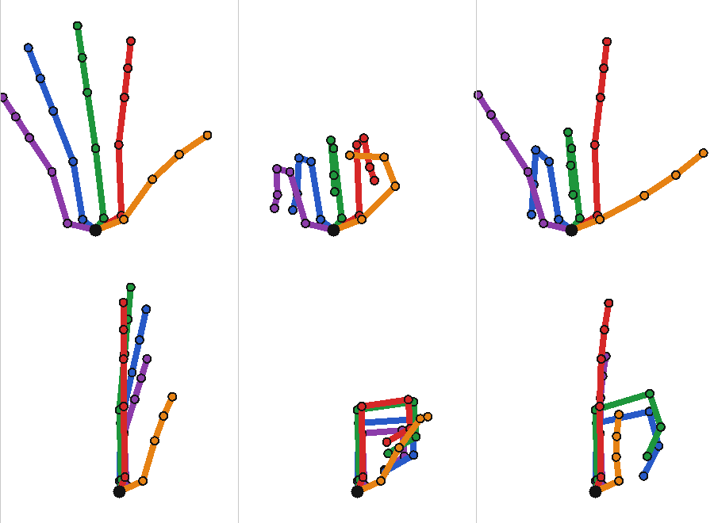

# Your body and your fists

In VR you are Spider-Man's own body now, not a camera with two gloves. Look
down and you see his torso, legs and arms; his hands are where the controllers
are and turn as you turn them; his head is gone, because you are inside it.
Hit a thug with your fist and the game takes it as a melee blow: he loses
health and reacts as hard as you hit him.

The body is the game's own hero model, its joints turned every frame
(`include/spidy/body_ik.hpp`, `src/body_ik.cpp`, engine independent;
`src/native_body.cpp` in the game). Punching has an engine-independent core
(`include/spidy/punch.hpp`, `src/punch.cpp`) and a game adapter
(`src/game_punch.cpp`) that hands each punch to the game's own damage system
(`native_bodies::damage`). Both are on by default: `Launch Spidy VR.cmd
-NoBody` keeps the hero hidden with gloves drawn over the image, as before;
`-NoPunch` lets fists pass through thugs. Spidy Launcher has a switch for each.

## What you see and do

| | |
|---|---|
| Look down | Spider-Man's body under you: arms to your controllers, legs on the ground |
| Turn your head | The body follows once you look more than 34 degrees away from it, and drifts after your head meanwhile; a snap turn (right stick) turns it at once, a smooth turn along with you |
| Crouch, lean | The knees bend and standing feet stay where they were; the torso bends a quarter of the way you pitch your head |
| Stand in a T-pose and hold both triggers | The calibration: Spider-Man takes your eye height and your arms' length ([below](#your-size-the-t-pose-calibration-october-8)); the first time VR shows the game, and from Settings > SPIDY VR > CALIBRATE BODY |
| Walk around your room | The feet stay put until your hips are 15 cm from over them, then follow |
| Swing, fall, jump | The legs keep the game's pose (a swing's tuck, a fall's flail) under your upright body |
| Flip (the left stick or A in the air, with the experimental FLIPS on) | The whole body turns with you about your eyes; the legs keep the game's pose |
| Shoot a web (or a web ball) | That hand makes the web-shooting hand: the two middle fingers pressed into the palm, the first and little fingers and the thumb out ([below](#the-web-shooting-hand-october-12)). Once the web holds (0.15 s after the shot) the hand closes into a fist on it, for as long as the button is held; a web that missed keeps the shooting hand that long (a web ball: half a second) |
| Take hold of the other hand's web | That hand closes into a fist on it |
| Squeeze a grip | Otherwise that hand closes into a fist |
| Move a hand fast | It closes into a fist too, and opens again within a third of a second; while it shoots it stays the shooting hand, unless an enemy is marked or within a fist's reach |
| Punch a thug | A fist moving 2.2 m/s or faster into him lands a blow (table below); the controller kicks |

How hard a punch lands depends on the fist's speed toward the thug, relative to
your body (not your swing or run). Since October 15 a punch deals 30% less
than it did (10 to 40 before):

| Fist speed | Damage | What it does to him (the game's knockback level) |
|---:|---:|---|
| 2.2-2.7 m/s | 7-9 | flinches (kTwitch) |
| 2.7-4.1 m/s | 9-14 | staggers (kStagger) |
| 4.1-5.4 m/s | 14-20 | is knocked back (kKnockback) |
| 5.4-6.7 m/s | 20-25 | is knocked down (kKnockdown) |
| 6.7-10.5 m/s | 25-28 | flies back (kFlyBack) |
| 10.5 m/s and more | 28 | flies far (kSuperFlyBack) |
| upward, from 4.3 m/s | as above | is popped up off his feet (kPopUp) |

A blow must go into him: within about 72 degrees of the line from the fist to
his middle or his head. A fist that grazes across his front, or is pulled back
out of him, lands nothing. A fist lands one punch per swing; it can punch again
once it slows below 1.2 m/s or 0.45 s later. A hand whose web holds a prop or
a thug, or carries you through the air, does not punch; one whose web only
hangs from a wall while you stand does (since October 11).

Since October 11 a fist thrown at a thug out of reach flies you to him (the
web strike), blows in a row count into a flow with a finisher, and the hard
blows, uppercuts and blows at a thug in the air go out as the game's kinetic
blow with a velocity for his flight: `include/spidy/web_strike.hpp`, and the
Fighting section of [PLAYERS.md](PLAYERS.md).

## How the body works

### The hero's joints

The game's animation jobs write every character's pose as model-space joint
matrices with 1601290 (pose job in rdx: rig at +0x28); its callers use the
float it returns (the largest joint movement since the last write). Right after
it writes the hero's (the render instance at the actor record's first field
keeps them at +0xd8), Spidy turns them. They are then skinned as the game drew
them. A joint matrix is four rows of four floats: the joint's x, y and z axes
in model space, scale included, then its position. Model space is the hero's:
+x his left, +y up, +z forward, the feet at the origin.

The rig the job names: joint count at +2 (u16); 16 bytes per joint at +8:
parent (s16 at +0, -1 for a root), a name hash at +8 and a name offset at +0xc;
the rest pose at +0x18 (48 bytes per joint: scale, rotation, translation,
relative to the parent). The name hash is 1bb88d0's: CRC-32 table steps seeded
with 0xedb88320, no final inversion (`pelvis` 8e59b33f). Spidy builds the rest
pose in model space with the game's own conversion, 1600770 (out, local pose,
joints, count), which places each root from the matrix before the first
joint; Spidy supplies an identity there.

The hero's rig, for every suit tried (237 joints): `a_body` is the body's root,
with `pelvis` (and under it `LF_upleg`, `LF_loleg`, `LF_foot`, and the right
side's) and the spine (`spine`, `spine_helper1/2`, `spine_B`,
`spine_B_helper1/2`, `chest`) under it; `chest` carries `neck` (with four
twist joints and their suit helpers), `head` (with the jaw, the eye deforms
and suit helpers), and the arms (`LF_clavicle`, `LF_uparm`, `LF_loarm`,
`LF_wrist`, forearm twist and bind joints under `LF_loarm`). Fingers A (index)
to D (little) run `LF_finger_B_A` (in the palm) to `LF_finger_B_D_end`; the
thumb `LF_thumb_A` to `LF_thumb_C_end`. The rig's other roots (`fx_root`,
`sync`, `cameraTarget`, `aimTarget`, the `*IK` targets) are gameplay's: the
body never moves them. `tools/probe_game_body.py` lists the rig with names,
parents and rest positions.

### Targets

The XR worker sends the body, every frame, the point between the eyes, the
headset's orientation, each controller's grip pose, the player's standing eye
height, the tracking space's yaw, a flip's tilt (command version 2; the
identity while level) and each hand's fist, all relative to the player's feet
in world axes: the anchor the eye views are placed from
(`native_eye_frame`). The eyes are moved to the hero's render position; the
body is drawn from the same instance; the hero rope sample and the render
transform agree (`hero_lag` 0.0 m over 41,378 frames on October 5). So the
body needs no timing for translation: a target goes into model space by the
hero's rotation alone. Only the hero's turn between his pose job and the render
shows (the session report's `body.turn_max`). Each command lasts 250 ms.

### The solver

From the game's pose, each frame, each step a rigid turn of a joint and
everything under it, a move of the whole body, or a scale about a point (so
skinning, helper joints and joint scales keep what the game animated; joint
frames may be mirrored, so no joint orientation is ever taken as a rotation):

1. The body scales about the feet to the player: their eye height over the
   rig's (1.697 m, between `LF_` and `RT_middle_eye_deform`). With a T-pose
   calibration it is the eye height measured then, within 0.7-1.3; without
   one, the standing eye height, within 0.85-1.2, which rises at once to a
   higher head and sinks 1 cm a second, so crouching does not shrink the body.
   A calibration's arm length then scales each arm, hand and all, about its
   shoulder (within 0.8-1.25): the player's arm from the hero's shoulder at
   their size to their wrist, over the hero's 0.559 m at that size.
2. The hips stand upright in the world (the world's up in model space: a hero
   crawling on a wall still gets a standing body), facing the body's yaw. The
   yaw follows the headset past a 0.6 rad dead zone at up to 6 rad/s and
   drifts toward it at 0.5 per second; a snap or smooth turn (right stick)
   turns it by as much at once, and a turn of the hero's actor turns it back
   (it stays put in the world).
3. The spine bends, in equal shares over its joints, toward a torso leaning a
   quarter of the head's pitch (at most 0.5 rad).
4. The neck takes half of the head's turn to the headset's orientation, the
   head the rest.
5. The whole body moves so the head joint sits where the headset's eyes say it
   is: the eye point from the head joint along the head's forward, up and left
   (0.1115 m ahead and 0.0505 m up, from the rest pose).
6. Standing feet (the game's within 0.3 m of the ground, the hero upright, not
   swinging) stay where the game put them, turned with the body's yaw, and
   follow the hips beyond 15 cm; each leg bends to reach its foot with the
   knee forward, the foot keeps the game's angle.
7. Each arm: the clavicle lifts toward a reach beyond 80% of the arm; the
   shoulder, elbow and wrist reach the wrist target (9 cm behind the grip
   point toward the forearm, 2 cm toward the back of the hand) by two-bone IK,
   the upper arm first rolled about itself so the elbow bends in the plane it
   bends in; the elbow hangs down, out and a little back. The hand takes the
   grip's orientation (the knuckles past the grip's -y, the palm facing +x on a
   left hand, -x on a right one), half of its roll taken by the forearm. Where
   the palm faces comes from the rest pose's knuckles: across the line from
   the index finger's knuckle to the little one's and along the four bones in
   the palm (the hero's rest pose holds its palms 30 degrees from down,
   toward the thumb).
8. A fist: each finger joint past the palm turns about its finger's own hinge
   (across the finger's bone in the palm and the palm's normal: the knuckle's,
   the one axis the rest pose gives all three joints) to 83, 95 and 63 degrees
   from the bone before it, however the game had bent it; a hand closed part
   of the way goes that share of the way from the game's bend. First each
   finger gathers in: its first bone turns that share of the way into the
   plane its knuckle bends in. The rest pose spreads the fingers (the index 9
   degrees one way, the ring and little fingers 12 and 16 the other), and
   until October 18 a closed hand kept that spread, its tips 4 cm apart where
   the knuckles are 2.3: a fanned claw. The thumb's last joint bends 63
   degrees about the thumb's hinge (across its first bone, toward the little
   finger), the joint before it as far as puts the tip as far from the thumb's
   base as the tip's place (at most 80 degrees), and the base swings the tip
   there: over the middle bones of the index and middle fingers, 1.6 cm out of
   the fist. Shooting a web goes over the fist (`Targets::Hand::shoot`, 0 to
   1): of the four fingers the first and the last go to 3, 5 and 3 degrees,
   nearly straight, and the two between them, gathered in, to 86, 92 and 63
   degrees, their tips on the palm as deep as a fist's, where the web
   shooter's trigger is (until October 18, 74, 89 and 43: 2 cm short of it);
   the thumb's two joints straighten to 6 degrees and its base swings it 57
   degrees from the fingers' way toward its own side, in the palm's plane. At
   1 the hand is that pose whatever the fist was; between, each joint is that
   share of the way from where the fist left it.
9. A flip (the left stick or A in the air, game_tracking's FlipMotion): the headset and the
   controllers go into steps 2-8 turned back level about the eyes, so the
   body is solved as if the player stood level; then everything under the
   body's root turns with the flip's tilt about the eyes. Tilted more than
   0.09 rad (5 degrees), the legs keep the game's pose, as in the air.
10. The head shrinks to a millimetre at its joint, 11 cm behind and 5 cm
    below the eyes; the neck stays.

The body blends in and out at 4 per second; the head shrinks at once while the
body is wanted, so the eyes never see it from inside. While the body is not
turning the hero's joints (another writer, a paused job, an unknown rig, no
command), the eyes hide the hero with the game's visibility switch, as before,
and the overlay draws gloves.

## Your size: the T-pose calibration (October 8)

You asked for an in-game calibration on first start, and as an option in the
VR menu, where the player stands in a T-pose and holds the triggers so the
avatar is scaled to their measurements. Before it, the body took its size
from the highest the headset had been (step 1 above) and kept the hero's own
arms, so a player with longer arms than his reached past his hands, and one
with shorter arms kept him bending his elbows.

The first time a session shows immersive play without a calibration (after
1.5 s of it, and not while a web flies the player), a panel appears 1.4 m
ahead and 12 cm below the eyes, where the player faces then; it stays in the
room. It says BODY CALIBRATION: stand tall, look ahead, arms straight out to
the sides, hold both triggers. A line under it says what to change, a bar
fills while the pose is held, a figure's arms and a ring around each
controller turn green while that arm is in place, and the rings fill with
the bar. After 1.5 s held, the panel says CALIBRATED with the eye height and
arm length for 3.5 s and both controllers buzz. B skips it. From its start
until each is let go after it, the triggers, grips, A and B do nothing in the
game (no web, web ball, jump or dodge); the sticks, the menu button, X and Y
work. A pause, a cutscene or the flat screen holds it until play returns.
Settings > SPIDY VR > CALIBRATE BODY: ON RESUME asks for it again when play
resumes (the row shows NO again once it starts).

**What counts as the pose** (`body_calibration::Calibration`, the first that
fails is what the panel asks for):

| Check | Panel line |
|---|---|
| Headset and both controllers tracked | KEEP BOTH CONTROLLERS IN VIEW |
| Eyes at least 1 m up | PLEASE STAND UP |
| Each arm, from the hero's shoulder at the player's size to the wrist, within 41 degrees of straight out to its side (crossed arms fail too) | STRETCH YOUR ARMS OUT TO THE SIDES |
| Each arm at least 72% of the hero's at that size; the two within 12% of the longer | STRAIGHTEN BOTH ARMS |
| The head within 26 degrees of level and 34 degrees of square to the arms | LOOK STRAIGHT AHEAD |
| Both triggers past 0.6 (then past 0.35) | HOLD BOTH TRIGGERS |
| The head under 0.3 m/s, each wrist under 0.35 m/s | HOLD STILL |

A lapse shorter than a quarter of a second pauses the hold; a longer one
starts it over.

**What is measured**, in the tracking space (the floor at 0) over the hold:
the eye height is the head's mean height. Each wrist is where the solver puts
it for that controller (9 cm from the grip toward the forearm, 2 cm toward the
back of the hand). The body faces square to the line between the wrists; the
hero's shoulder there is where his rest pose holds it from the point between
his eyes (0.111 m behind, 0.266 m below and 0.170 m to the side, times eye
height / 1.697: `body::Rig::shoulders`, `body_calibration::Proportions`, read
from the hero's rig once the body has run). Each arm's reach is from that
shoulder to its wrist, averaged; the arm length is the longer arm's (the
straighter one). A player with eyes 1.62 m up and wrists 0.60 m from those
shoulders gets a body at 0.955 of the hero's size and arms 1.124 times longer
on top (0.60 / (0.559 x 0.955)).

**Where it is kept.** The session reports the eye height and arm length in
millimetres (XrData `eyeHeightMm`, `armLengthMm`; the session's last line
`eye_height_mm=` and `arm_length_mm=`), and the launcher keeps them in
launcher.ini and passes them to every next session (`--eye-height`,
`--arm-length`), which then asks for none. Skipped, the session reports
`calibration_prompt=0` and the launcher passes `--no-calibration-prompt`. The
launcher's "Body calibration" row shows the measurements, and its Redo (or Ask
again) forgets them so the next session asks. "Reset options" keeps them.

In the game without a headset (`tools/probe_game_body.py --phases tpose`,
October 8, `reports/body-probe-tpose.json`): eyes 1.66 m up as a calibrated
height (body 0.978) and both wrists 0.62 m straight out from the rest pose's
shoulders. With the hero's own arms they stopped 8.5 and 7.1 cm short of their
controllers (left, right); with that arm length his arms scaled 1.135 and
ended 2.7 and 0.8 cm from them. The rest comes from his standing pose: its
shoulders sat 3-7 cm higher than the rest pose puts them, the far reach
lifting the clavicles. A few percent more arm would close that gap at the cost
of slightly bent elbows when the player's arms are straight; how it feels
needs the headset.

The panel's text is a stroke font of capitals, digits and punctuation drawn
as flat bars in the panel's plane (`src/overlay_text.cpp`), opaque over the
eye images like the rest of the overlay. Measured on the GPU test's eye image
(1536 pixels for 92 degrees, below a Quest 3's density): every line reads.

## How punching works

Every controller sample reaches the swing's world-query callback
(`game_swing.cpp`), where the web grab takes it too. The fist is 15.5 cm
along the hand from its web shooter (the aim, `webShooter`: the suit's
nozzle, the rig's webStart joint, since October 18), at the knuckles; its
speed is that of the grip relative to the
head, turned from tracking space into the world: the arm's own motion, whatever
the player's flight. The characters are the game's bots, kept by a registry
watch (`game_targets`, every 250 ms), each an upright capsule from his feet,
1.8 m tall and 0.3 m around for a street thug; since October 9 another bot's
is that carried over to his size, the capsule his mover collides with
(`game_targets::Size`). A fist sphere of 8 cm swept from its last sample
to this one finds the first bot it enters; the punch's strength and reaction
follow the tables above.

A punch becomes the game's own melee damage: a direct request to the game's
DamageSystem (the static object at 62a4ec0). 1eb6d60 (system, target handle,
hit direction, hit point, hit normal) hands out a DamageRequest from its pool;
Spidy fills its reflected fields (`Damager` +0x138 the hero, `Type` +0x13c 1
kMelee, `Amount` +0x144, `Knockback` +0x150, `KnockbackAmount` +0x154,
2 + 6 × strength), each with its bit in the masks at +0x8 and +0x18 (the bit is
the field's index in the reflection: 8 Damager, 9 Type, 11 Amount, 14
Knockback, 15 KnockbackAmount, 23 ImpactImpulse, 26 DamageHash). The pool has
no lock, so `native_bodies` issues requests on the main thread inside
hknpWorld::preCollide at the next physics step. The system processes the
request later in the frame (1eb8cf0): it drops one whose Damager does not
resolve, derives the Category from the Type, applies the victim's damage
modifiers and delivers a DamageEvent; `Health::OnDamage` (1f15a10) takes the
hit points at Health +0x88 unless the victim is dead or refuses the damage
(response bits 0x10, 0x20). An actor's handle is (generation << 20) | index of
its record in the actor table [7a44380] (0xc0 bytes a record; generation at
+0x10, 11 bits; index at +0xc, 20 bits).

The knockback levels (`Knockback`, from the game's own enum names): 0 kNone,
1 kTwitch, 2 kStagger, 3 kKnockback, 4 kKnockdown, 5 kFlyBack, 6 kAirborne,
7 kPopUp, 8 kAirJuggle, 9 kSuperFlyBack. Damage types: 1 kMelee, 7 kKinetic,
25 kDrain among 31.

The controller kicks with each landed blow: 0.6 + 0.4 × strength for 60 to
140 ms, full strength for 180 ms for a heavy one and 320 ms for a finisher,
with the other hand too; the web's tension rumble waits for it. The game's
time stops for a moment, a burst shows where the blow landed and it sounds
(`game_xr.cpp`; until October 11 it was one 25 ms pulse at 0.5 + 0.5 ×
strength and nothing else).

## Measured in the game without a headset

`tools/probe_game_body.py`, on the rooftop of the user's save (the hero perched
on a vent cap), October 6 (`reports/body-probe*.json`, images in
`reports/body-probe/`):

| | |
|---|---|
| The hero's rig | 237 joints, every name found, one pose job per render frame |
| Body on, scripted headset at 1.75 m eye height, left hand raised, right hand punching ahead | both wrists 0.0 mm from their targets in the world, the head joint 0.0 mm from its place, the head at 0.001 of its size, body scale 1.031 |
| Solve time | 0.03 ms a frame on the game's job thread |
| From the eyes, looking 50 degrees down | his right arm reaching ahead to the scripted controller, gloved hand and web shooter, his feet on the vent cap below; nothing of the head |
| Body off | the hero hidden, as before |
| Fist | the four fingers curled toward the palm, the thumb across them; their tips were bent back, which this image was too small to show ([Twisted fingers](#twisted-fingers-october-8)) |
| A blow straight to the DamageSystem (30, kFlyBack) on a bot 126 m away | its health 100 to 67 |
| The same on the hero (5, kStagger) | his health 110 to 105; he was shoved 7.9 m |
| A scripted fist through a bot's chest at 6 m/s, through the swing's input as a controller's | one punch: 5.6 m/s, strength 0.64, kKnockdown, 29.1 damage; one request issued; the bot's health 100 to 68 |

The bots in reach were in `BotStatePlayCinematicGame` (a scripted scene): they
lost health but played no reaction. No free-roaming thug came within reach in
these sessions (bots are scarce in free roam; see
[WEB-GRAB.md](WEB-GRAB.md#bots-built-not-yet-verified-in-the-game)). A
throwable trash can ignored a kMelee blow of 1000 from 95 m: props refuse melee
damage, and punching props does nothing yet.

## The first headset session (October 6, 16:36)

`game-vr-20261006-163630.json` in the play folder, about 23 minutes; its
samples cover the last 10 (737-1359 s):

| | |
|---|---|
| The body on the hero | in every one of 10,761 samples with the eye views on |
| At full blend (10,459 samples) | the head joint 0.0 m from its place in every one; the left wrist within 1 cm of its target in 96% of them, the right in 89%; at most 0.20 m, a controller beyond the arm's reach |
| The hero's turn between his pose job and the render | none in all but 21 samples; at most 0.099 rad (5.7 degrees) in the session |
| Below full blend with the eye views on | 302 samples, about 16 s: the defect below |
| Punches | none: see below |

**The blend restarted from nothing for seconds at a time** (788-796 s,
826-830, 1135-1137, 1186-1189 and 1312): from 1 to under 0.1 within a frame,
then again every frame or two, so the hero showed mostly the game's own
animation: his arms away from the controllers by up to 1.9 m, his head joint
up to 2.2 m from its place (the head itself stayed shrunk). Each time the game
was moving the hero itself: a landing at 30 m/s after letting go of a web, a
ledge climb, a jump off a roof from a standstill. Only a change of rig in the
hero's pose job restarted the blend (the body read the rig again and started
over), so the hero's pose jobs were alternating between rigs. Since that
evening each rig keeps its own entry (four at most, read again when one names
other joint tables) and the body's blend and yaw stay across rigs; they start
over only on another actor. The eyes also hide the hero when his latest pose
job is one the body could not turn (a rig without the joints it needs), whatever
an earlier job of the frame did. The status counts the jobs that changed rig
(`rig_switches`) and the most hero jobs in one frame (`hero_jobs_max`); each
session sample has the rig. Not yet run in the game.

**No punches:** every fight in that session showed the flat game screen (the
combat camera never went through the camera commit Spidy follows; fixed
separately that evening, [VALIDATION.md](VALIDATION.md)), and fists punch only
from tracked controllers with the eye views on. The session did not record
whether a thug came within reach while they were on; samples now carry
`punch` (the bots within reach of a fist, the punches, each fist's speed).

## Twisted fingers (October 8)

You reported that your fingers in VR look twisted and tangled in most poses.
The eye snapshots of your October 7 23:11 session show it while you swung
(the grips held): at 64-68 s the right fist is a claw with its fingertips
bent up out of it, and the left hand's fingers bend back out and cross each
other. A hand closes into a fist whenever its grip is squeezed (every web)
or it moves faster than 1.2 m/s against the head, which is most of play.
Two faults in the fist:

- Each joint bent toward the palm's normal about the axis across the bone
  before it and that normal. That axis turns over once a bone has curled
  past the normal: at a full fist the middle bones point back at 178 degrees
  from the bones in the palm, so every fingertip joint bent 60 degrees
  backward. From a hand the game had already closed (its own fists) the
  middle joints folded back through themselves.
- The palm's normal was assumed: a rest pose holding its palms down. The
  hero's rest pose holds them 30 degrees from down, toward the thumb
  (measured from the knuckles), so the fingers closed diagonally across the
  palm into each other, and every hand sat rolled 30 degrees on its
  controller. The game's own bends agree with the knuckles: in the perch pose
  of the October 6 probe (`reports/body-probe-fist.json`) it bends each
  finger's middle and tip joints about axes 3-9 degrees from the knuckles'
  hinge, 24-32 degrees from the assumed one.

Now each joint turns about its finger's own hinge to a set bend (step 8
above), and the palm comes from the knuckles (step 7). Spider-Man's own hands
(the rig's rest positions) in the solver, before and after:

| | Before | Now |
|---|---|---|
| Palm against the controller's palm | 29.9 degrees off | 0.0 |
| Full fist, each finger's knuckle, middle and tip joint | 82, 96, -60 degrees (tip bent back) | 83, 95, 63 |
| Half fist from the game's own fist | ring finger's middle joint 172, little finger's -175 | 92-100, 102, 66 |
| Fingertips off their finger's own plane | up to 7.1 cm | 2.6 cm, the rig's own spread |
| Thumb | folded toward the palm's normal, then turned at its base and middle joint toward the index finger's middle joint, with no hinge | 59 and 63 degrees about one hinge, the tip 1.6 cm out of the fist |

Not yet seen in the game or the headset: `tools/probe_game_body.py --phases
rig,ik,eyes --fists 0.5,1` reports each hand's palm against its controller,
every finger joint's bend and the thumb (`ik.hands`), and draws the right
fist from the eyes.

## The web-shooting hand (October 12)

You asked for "hand poses like the real iconic ones from spiderman on web
shootinh". Until then a squeezed grip was a fist and nothing else, and the
grip is what shoots a web: every web left a clenched hand.

Spider-Man's own left hand (the rig's rest positions) in the solver: open as
the rest pose has it, the fist, and the shooting hand. Top row: seen onto the
palm, the thumb's side to the right. Bottom row: from the thumb's side, the
palm facing right. Index red, middle green, ring blue, little purple, thumb
orange.

When the hand makes it (`include/spidy/hand_pose.hpp`, `HandPoser`, one per
hand in the XR worker):

| | |
|---|---|
| The web button going down (the grip, or the trigger with WEB BUTTON: TRIGGER) | the pose comes with it: the button's value over 0.65, where it shoots |
| The button held (past 0.65, until it is back under 0.35) and the web missed | the whole pose, for as long as it is held; let go, it goes in 0.2 s |
| Its own web holds (hanging from something, or holding a thug or a prop it caught) | the whole pose for 0.15 s after the web took hold, while the shot is on its way (`connectSeconds`); then the pose goes in 0.2 s and the hand closes on the web, a fist as far as the button is down, with the trigger as the web button too. The first build kept the pose 0.3 s and then closed the hand on the web ("the web shooting pose turns almost immidiatly to a fist"); the second kept it as long as the button was held, swinging too ("when web connects and held lets change the hand to fist and not keep the horn pose", October 15) |
| The hand on the other hand's web (the tick), and while it holds that web | no pose: the button closes a fist on the strand, with the trigger as the web button too, where the grip is open |
| A web ball leaving the hand | the whole pose for 0.5 s |
| The hand moving faster than 1.2 m/s against the head | a fist, as before, under the pose: it shows as the pose goes |
| The same with an enemy marked (the ring) or within a fist's reach | the fist wins: the pose is scaled down by how fast the hand is, to nothing at 2.5 m/s |

Checked: the solver's angles and the thumb's place on Spider-Man's hand, from
an open hand, over a fist and half way (two tests); the timing above (two
tests); the picture. In the headset once (October 12, 21:53, the first build):
too short to judge, by your word; its shape drew no remark. Not looked at on
the hero's mesh in the game without a headset:
`tools/probe_game_body.py --phases rig,ik,eyes --shoots 0,1` draws it there.

## Open

- The web-shooting hand on the hero's mesh and in the headset: whether the
  two pressed fingers reach the palm or go into it, and whether the fist
  comes as the web lands. The game's rope draws the shot; its update
  (`679dc0`) appears to time it from the rope's age (`+0x6b4`) against its
  type's settings (`[rope + 8] + 0xc0..0xc8`), whose values were never read,
  so `connectSeconds` (0.15 s) is a guess.
- How the new fists and the 30-degree palm correction look and feel in the
  headset; the probe above in the game.
- A thug in a fight reacting to a punch (his hit reaction, knockdown, flight)
  needs a crime or the headset: the bots measured were scripted, and the first
  headset session's fights were on the flat screen.
- Which rigs the hero's pose jobs alternate between during the game's own
  moves, and whether the body now stays on through them (`rig_switches`,
  `hero_jobs_max`, the per-sample `body.weight`).
- The wrist offset from the grip point and the hand's orientation are from the
  OpenXR grip pose's definition; how they feel needs the player's word.
- With the body in each eye's depth, the eyes' occlusion culling may hide
  something behind a fast-moving hand for a frame (compare `-NoEyeOcclusion`);
  the game's "Non Occluder" instance flag would keep the body out of it.
- The lab has neither a body nor punching yet.
- The T-pose calibration in the headset: how the panel reads and the pose
  holds, and how the measured arms feel. The calibration takes the hero's
  shoulders from his rest pose; in his standing pose they sit 3-7 cm higher,
  which leaves straight arms up to 2.7 cm short of the controllers.

## Tuning

`body::Config` (`include/spidy/body_ik.hpp`) and `PunchConfig`
(`include/spidy/punch.hpp`) hold every number above, with their reasons;
`PunchConfig` rejects inconsistent values. The XR worker closes a hand into a
fist by the grip squeeze or by its speed relative to the head (fully closed at
2.5 m/s, opening at 3 per second).

## Validation

`spidy_tests.exe` has 21 checks for this: the rest pose's references and
refused rigs (a cycle, a missing hand, a rest pose lying down, a finger beyond
the rig); hands reaching the controllers with every bone keeping its length,
also with turned and mirrored joint frames; the head behind the eyes and
shrunk; upright hips from a face-down swing pose; standing feet kept while
crouching, airborne legs kept; the dead zone; blending in and out (the game's
pose untouched until then); an out-of-reach arm stretched toward its
controller; a body standing on a wall; a snap turn; a fist with its thumb
across; with Spider-Man's own hands (both, also with turned and mirrored
frames), each palm facing its controller's, every finger joint closing a
quarter, half or all of the way to its bend and never back (from straight
fingers, fingers bent back and the game's own fist) with the fingertips side
by side in the palm, and the thumb bending in one plane onto the fingers; a
taller player's body scaled about the feet; a player's longer arms reaching
their controllers, each scaled about its shoulder; the calibration's
proportions from a rig and its scales' ranges, a T-pose held 1.5 s measuring
the eye height and the longer arm, each check's panel line, a short lapse
pausing the hold and a longer one restarting it, the panel's place and
drawing; and for punching, one
punch per swing as hard as the fist went in, no punch for touches, grazes, a
busy hand or a fist carried along by flight, uppercuts and very hard blows, a
short punch from within reach, the capsule's side and caps, and configuration.
`tests/game_vr_protocol_tests.py` checks the body and punch telemetry layouts.
